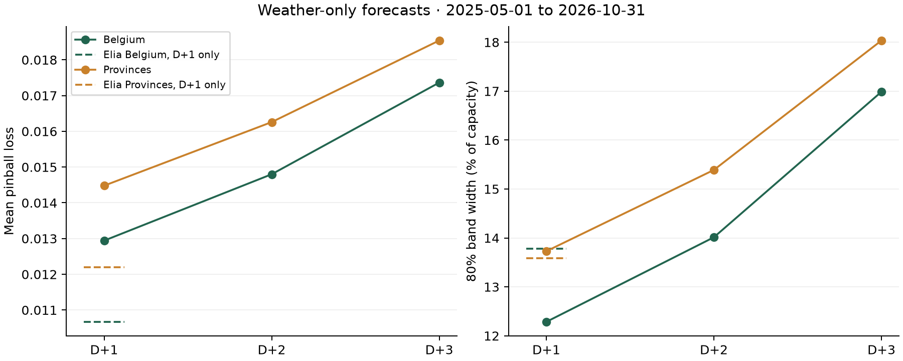

# Experiments

All scores are on daylight quarter-hours, as a share of monitored capacity. Weather is at least 48 h old at the
11:00 D-1 cutoff. v1 was frozen in 2d11d22 and run once on the test window. v2 was chosen on validation,
frozen in 6e8d5b8, then run once on the same test window.

## Validation, 2025-05..2025-10 (184 days)
| Change | Scope | Pinball | MAE | Cover 80 | Width | Verdict |
|---|---|---|---|---|---|---|
| Elia day-ahead 11h | Belgium | 0.0111 | 3.28% | 80.4% | 13.8% | reference |
| Elia day-ahead 11h | Provinces | 0.0126 | 3.86% | 73.9% | 13.6% | reference |
| Quartz on 48 h ICON | Provinces | | 10.9% | | | public baseline, bias +7.3% |
| Weather + lags, conformal | Provinces | 0.0157 | 5.20% | 78.3% | 14.1% | half of Quartz's MAE |
| Weather, no lags, scoped calibration | Provinces | 0.0157 | 5.23% | 79.4% | 14.2% | no history needed: kept for any site |
| Stack on TSO inputs, conformal | Belgium | 0.0111 | 3.55% | 84.1% | 12.1% | tie, median worse |
| H1 residual quantiles on TSO P50 | Belgium | 0.0106 | 3.31% | 85.7% | 12.1% | CI excludes 0 |
| H1 + H3 calibrate Belgium apart | Belgium | 0.0105 | 3.31% | 79.6% | 10.4% | fixes over-coverage |
| H1 + H2 trailing TSO error + H3 | Belgium | 0.0104 | 3.28% | 79.8% | 10.3% | **frozen** |
| H1 + H2 trailing TSO error + H3 | Provinces | 0.0120 | 3.78% | 79.9% | 11.9% | **frozen** |
| Same with 500 trees | Belgium | 0.0106 | 3.37% | 79.8% | 10.6% | worse, rejected |
| Open-Meteo Single Runs API for fresher runs | | | | | | run not available for 2024 or 2025, dead end |

## Test, 2025-11..2026-10 (359 days), single run
| Method | Scope | Pinball | MAE | Cover 80 | Width |
|---|---|---|---|---|---|
| Elia day-ahead 11h | Belgium | 0.0104 | 3.08% | 83.4% | 13.7% |
| Penumbra grid | Belgium | 0.0097 | 3.05% | 80.3% | 9.8% |
| Elia day-ahead 11h | Provinces | 0.0120 | 3.63% | 76.5% | 13.6% |
| Penumbra grid | Provinces | 0.0111 | 3.50% | 80.5% | 11.1% |
| Penumbra weather only | Provinces | 0.0138 | 4.34% | 79.6% | 13.4% |
| Quartz on 48 h ICON | Provinces | | 11.9% | | |
| Persistence, D-2 | Provinces | | 8.97% | | |

Paired daily pinball difference against Elia, 2,000 block bootstrap draws, Penumbra grid:
Belgium -0.00067 [-0.00097, -0.00038]; provinces -0.00078 [-0.00103, -0.00054].

## Operator value, Belgium, 11.76 GW monitored
| Metric | Elia | Penumbra | Period |
|---|---|---|---|
| Mean band | 1,616 MW | 1,154 MW | test |
| Mean P10 | 1,919 MW | 2,116 MW | test |
| Share of time output met P10 | 91.9% | 89.7% | test |
| Settlement difference, P50 nomination | | +361 EUR/MWp/yr [87, 638] | test |
| Settlement difference, P50 nomination | | -114 EUR/MWp/yr [-538, 302] | validation |

The settlement gain is not stable across the two periods, so it stays out of the headline numbers.

## Portability: Belgium-trained, no GB data in training or calibration, 2025-11..2026-10
| Region | Pinball | MAE | Cover 80 | Width |
|---|---|---|---|---|
| Eastern | 0.0135 | 4.16% | 75.6% | 13.4% |
| Southern | 0.0138 | 4.24% | 73.7% | 13.3% |
| South-Western | 0.0130 | 4.05% | 76.9% | 13.8% |
| All three | 0.0134 | 4.15% | 75.4% | 13.5% |

Same three regions, on the 48,899 rows both models cover: Quartz on 48 h ICON MAE 11.1%, bias +7.2%; Penumbra 4.14%.
Band coverage falls short of the 80% target when a region supplies no outcomes, so the site reports this figure.

## Monthly coverage of the 80% band, Belgium, test window
Penumbra 72.5% to 85.4%, lowest in January; Elia 73.5% to 93.2%.

## Forward check after the test
Backfilled days since Elia's new datasets, 2026-10-26, 10-27, 11-01, 11-02, Belgium: Penumbra pinball 0.0081, Elia 0.0096; coverage 68% and 86%; band 7.9% and 12.5%.
Four autumn days are too few to judge, so the live ledger decides whether coverage holds.

## Round 2, validation 2025-05..2025-10 (user asked to go well beyond Elia, 11-03)
Paired daily pinball difference against Elia, Belgium; v1 frozen = -0.00065.
| Change | Belgium diff [95% CI] | Provinces diff | Verdict |
|---|---|---|---|
| Season-aware calibration, 30 or 90 day windows | within 0.0001 of v1 | same | no winter in validation, no gain |
| 5-seed bagging | -0.00071 [-0.00101, -0.00041] | -0.00067 | small |
| D-1 morning measured vs Elia, 06-08 UTC | -0.00074 [-0.00104, -0.00044] | -0.00070 | small gain |
| Tuned: 400 trees, lr 0.02, 15 leaves, min child 1000, colsample 0.6 | -0.00081 [-0.00110, -0.00053] | -0.00075 | best single change |
| + fresh GFS 00z of D-1 (NOAA archive) | -0.00087 [-0.00116, -0.00057] | -0.00079 | small gain |
| + gaps between each forecast and Elia's median | -0.00089 [-0.00121, -0.00058] | -0.00078 | small gain |
| Train on the last 240 days only (learning curve) | -0.00064 | -0.00059 | more history matters |
| + fresh ECMWF IFS 00z of D-1 (open-data archive) | -0.00092 [-0.00121, -0.00061] | -0.00080 | no gain over GFS |
| Training history from 2021 (Elia + GFS; 48 h features from 2024) | -0.00101 [-0.00126, -0.00073] | -0.00094 | best |
| History from 2021 + ECMWF | -0.00096 | -0.00090 | no gain |

Same 119,958 validation rows for every variant, share of Elia's pinball (Belgium / provinces):
v1 -6.0% / -5.0%; gaps -7.8% / -6.0%; + ECMWF -8.1% / -6.1%; history from 2021 -9.1% / -7.4% (MAE 3.10% vs Elia 3.28%);
average of the last two -9.0% / -7.2%. Coverage of the 80% band 78% to 79% for all round-2 variants.

## Test v2, 2025-11..2026-10 (359 days), single run of the pipeline frozen in 6e8d5b8
The test window was first used by v1 (2d11d22). v2 was chosen on validation only and frozen before this run.
Rows come from the extended table, so Elia's own scores differ slightly from the v1 table.
| Method | Scope | Pinball | MAE | Cover 80 | Width |
|---|---|---|---|---|---|
| Elia day-ahead 11h | Belgium | 0.0101 | 2.98% | 81.9% | 13.3% |
| Penumbra v2 | Belgium | 0.0090 (-10.8%) | 2.79% | 80.2% | 9.1% |
| Elia day-ahead 11h | Provinces | 0.0117 | 3.54% | 75.4% | 13.2% |
| Penumbra v2 | Provinces | 0.0105 (-10.0%) | 3.28% | 80.2% | 10.5% |
Paired daily pinball difference: Belgium -0.00106 [-0.00134, -0.00077]; provinces -0.00112 [-0.00135, -0.00090].

<!-- horizons:start -->
## Horizons

Weather-only models. Fixed features and parameters for all horizons. 2025-05-01 to 2026-10-31. Common daylight rows: 321,625 across 549 days. Monthly refits and rolling scoped calibration use a gap of 2, 3 or 4 days. Full-day lags end before the issue day; the frozen weather specification uses no output lags. Elia is a D+1 reference only. Its score uses rows with a published day-ahead forecast.

| Horizon | Scope | Pinball | MAE | Cover 80 | Width |
|---|---|---|---|---|---|
| D+1 | Belgium | 0.012942 | 4.19% | 79.07% | 12.28% |
| D+1 | Provinces | 0.014479 | 4.68% | 79.47% | 13.73% |
| D+2 | Belgium | 0.014799 | 4.80% | 78.62% | 14.01% |
| D+2 | Provinces | 0.016258 | 5.26% | 79.29% | 15.39% |
| D+3 | Belgium | 0.017364 | 5.54% | 79.13% | 16.99% |
| D+3 | Provinces | 0.018541 | 5.93% | 79.67% | 18.04% |

<!-- horizons:end -->
