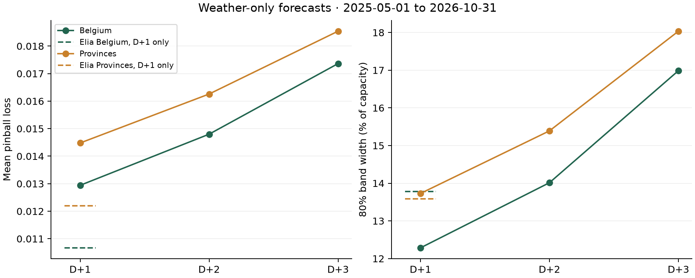

# Penumbra

**Solar, with a margin.** Penumbra is two things built on one idea, learning the forecast error. **A grid model** forecasts Belgium's solar fleet every day beside Elia, the grid operator, and is scored in public. **A planning tool** brings the same calibrated P10–P90 approach to any place and panel setup: drop a pin, describe your panels, and get a low, expected and high range for today and the next three days, the best solar window, and a conservative plan at the margin you choose. Free, no account, installable on a phone, and the model runs on your device.

The grid model is where the headline comes from. Penumbra publishes its national forecast every day next to Elia's and scores both in a public, hash-chained ledger. On 359 held-out test days (November 2025 to October 2026, day-ahead) it cut pinball loss by **10.8%** against Elia's own probabilistic forecast, with a band almost a third narrower (**9.1% vs 13.3%** of capacity) while still covering **80%** of outcomes.

**Live site:** https://yy5652-hash.github.io/penumbra/
**Check the headline in seconds:** `evidence/` holds every scored test quarter-hour for Penumbra and Elia; `python src/verify_headline.py` recomputes the results table and confidence intervals without retraining and prints PASS.
**Presentation:** https://yy5652-hash.github.io/penumbra/deck.html · [PowerPoint download](https://yy5652-hash.github.io/penumbra/Penumbra_DATANOVA_2026.pptx)
Built for DATANOVA 2026, track DN-SU-01 Solar Energy Generation Forecasting.

## Use it

1. **Pick a place**: map, search, GPS or an example. A forecast appears straight away for a default 5 kW, 35° south roof.
2. **Describe your roof**: up to three arrays (for example east and west), each with capacity, tilt and direction, plus an optional inverter limit. Orientation uses Open-Meteo's forecast irradiance on the tilted plane.
3. **Read the range**: Today, Tomorrow, In 2 days, In 3 days; P10, P50 and P90 energy; a 15-minute chart; the best solar window for the selected day, and an optional check of how much of a planned load the low case covers.
4. **Plan**: the margin slider turns the band into a conservative plan for the day.
5. **Keep it**: save sites on this device, share a link, export CSV or JSON, install the app; the last forecast stays readable offline.

## Results

359 test days, 2025-11 to 2026-10. Scores cover daylight quarter-hours as a share of monitored capacity.

| Method | Scope | Pinball | MAE | 80% band coverage | Band width |
|---|---|---|---|---|---|
| Elia day-ahead 11:00 | Belgium | 0.0101 | 2.98% | 81.9% | 13.3% |
| Penumbra v2 | Belgium | 0.0090 (-10.8%) | 2.79% | 80.2% | 9.1% |
| Elia day-ahead 11:00 | 11 provinces | 0.0117 | 3.54% | 75.4% | 13.2% |
| Penumbra v2 | 11 provinces | 0.0105 (-10.0%) | 3.28% | 80.2% | 10.5% |

- Paired daily pinball difference: Belgium -0.00106 [-0.00134, -0.00077]; provinces -0.00112 [-0.00135, -0.00090] (95% confidence intervals).
- Three British regions the model never saw: MAE 4.14% against 11.1% for Quartz on the same rows, with 75.4% band coverage and no local calibration.
- The average Belgian band falls from 1,561 MW to 1,073 MW. Mean P10 rises from 1,851 MW to 2,054 MW. Output met P10 in 89.9% of intervals for Penumbra, against 90.4% for Elia.

`EXPERIMENTS.md` records every run, including the variants that were rejected.

## How it works

1. **Inputs that existed at the cutoff.** Inputs include four weather models from runs at least 48 hours old, fresh GFS 00z of D-1 from the NOAA archive, and D-1 morning measured output before the 11:00 cutoff. Training history starts in 2021. Other output lags stop at D-2.
2. **Residual quantiles.** LightGBM learns P10, P50 and P90 of the gap to Elia's median, refit monthly on past data with a 2-day gap.
3. **Rolling calibration.** Conformal shifts from the trailing 60 days, by band width and sun height, with national and provincial rows apart.

The test window was used twice: first by v1, then by v2, which was chosen on validation and frozen in 6e8d5b8 before its single run. The first frozen version was v1 (`2d11d22`).

### Forecast tool, technical notes

The tool runs its weather-only model in the browser. Pick a place by map, search, GPS or example chip to get a default 5 kW, 35° south array. Today (remaining hours) uses the D+1 model and shifts; tomorrow through D+3 retain their original models. Daily cards show summed P10/P50/P90 energy, and the best 2–3 hours tomorrow maximise P10 energy. These sums are not calibrated daily quantiles or guarantees.

Up to three named arrays share kW or MW units. Each array scales the calibrated fleet shape by capacity and the Open-Meteo forecast GTI ratio to 35° south, bounded to [0, 3] (1 below 20 W/m² reference GTI); hourly backward means align to each quarter-hour’s enclosing hour. The site sum is then clipped at the optional inverter AC limit. A single default array skips the orientation adjustment entirely and keeps the previous numbers exactly. Failed GTI requests use the existing clear-sky ratio with a visible note. No extra temperature derating is added. The multi-array and AC-clipping approach is adapted from [rany2/open-meteo-solar-forecast](https://github.com/rany2/open-meteo-solar-forecast) (MIT; [licence](site/vendor/open-meteo-solar-forecast.LICENSE)). [Method and limitations](site/how.html#plant-geometry).

My sites saves, renames and deletes local device configurations with tomorrow previews. Old share links remain valid; new links include arrays and AC limits. CSV/JSON include best hours and array settings. The PWA uses relative scope for `/penumbra/`, caches the app shell, downloaded models and weather, and shows the last opened forecast offline with its save time. Storage failures do not prevent a forecast or share link. Map: vendored [Leaflet 1.9.4](https://leafletjs.com/reference-1.9.4.html), BSD-2-Clause, [licence](site/vendor/leaflet/LICENSE); tiles © [OpenStreetMap contributors](https://www.openstreetmap.org/copyright). GTI parameters follow the [Open-Meteo Forecast API](https://open-meteo.com/en/docs): azimuth 0° south, −90° east, +90° west.

V3 browser acceptance (Playwright 1.64.1, installed under `tools/`): `node tools/check-v3.mjs`. It serves the actual `/penumbra/` sub-path, uses recorded weather/GTI fixtures, verifies offline reload with a service worker, and writes 375/1440 px screenshots of each main screen under `data/v3-shots/`. Use `--shots-dir /tmp/penumbra-v3-shots` to keep verification output outside protected data directories.

## Public ledger

`ledger/<date>.json` holds one forecast per target date, written once, with the SHA-256 of the previous file. `ledger/scores.json` scores each finished day. Live forecasts begin with 2026-11-04. Target dates from 2026-11-08 use v2 for grid forecasts; new forecast files and daily scores record the model version. Earlier files are marked `backfill`, because they were computed afterwards from data available at their cutoff. Elia published no 11:00 forecast for 2026-10-28, so that date has no entry; 10-29 to 10-31 appeared later and are backfill.

## Reproduce

```bash
uv venv --python 3.11 .venv
uv pip install --python .venv/bin/python pandas pyarrow lightgbm scikit-learn requests matplotlib eccodes
export PYTHONPATH=src
.venv/bin/python src/download_elia.py
.venv/bin/python src/download_elia.py hist
.venv/bin/python src/download_weather.py
.venv/bin/python src/download_prices.py
.venv/bin/python src/download_gfs.py 2021-01-01
.venv/bin/python src/features.py
.venv/bin/python src/features.py extended
.venv/bin/python src/backtest.py val
# Frozen v2 test artifacts are already recorded; do not rerun the test window.
.venv/bin/python src/value.py test_v2
.venv/bin/python src/download_gb.py
.venv/bin/python src/portability.py
# Fixed-spec D+1..D+3 experiment and browser exports
.venv/bin/python src/download_weather.py 3
.venv/bin/python src/download_weather.py 4
.venv/bin/python src/horizons.py
.venv/bin/python src/horizon_evidence.py
.venv/bin/python src/export_site.py horizons 2026-11
.venv/bin/python -m unittest src/test_horizons.py -q
node --test site/test/*.test.mjs
python3 -m http.server --directory site 8765
```

The 14-slide browser presentation and PowerPoint use `deck/content.js`. Rebuild both with `npm ci --prefix tools` then `NODE_PATH=$PWD/tools/node_modules node deck/build.js`. The HTML deck uses inline SVG charts, arrow keys, touch navigation and one slide per printed page.

For a reboot-safe round-3 run, use `.venv/bin/python tools/resume-round3.py`. Completed monthly predictions, model files and fixtures are reused. Logs and stage checkpoints are saved in `data/round3/`. Browser checks and gallery capture require a local session that can launch Playwright Chromium.

Run `.venv/bin/python tools/resume-round3.py --orientation-only` for the plant-geometry browser checks. They use recorded weather fixtures and cover defaults, adjustments, exports, share restoration, input limits and phone layout. `--browser-only` includes these checks after the horizon, deck and gallery stages.

On macOS without Homebrew libomp, prefix the LightGBM commands with `DYLD_LIBRARY_PATH=$PWD/.venv/lib/python3.11/site-packages/sklearn/.dylibs`. Quartz runs in its own environment: it pins quartz_solar_forecast 1.2.12, numpy 1.26.4, scipy 1.17.1 and pyarrow 17.0.0 (see `src/quartz_baseline.py`).

## Sources and credits

- Solar generation and forecasts, imbalance prices: [Elia Open Data](https://opendata.elia.be/), Elia Transmission Belgium SA, CC BY 4.0. Values are converted to a share of monitored capacity.
- Fresh GFS 00z runs: [NOAA GFS archive](https://noaa-gfs-bdp-pds.s3.amazonaws.com/).
- Weather and geocoding: [Open-Meteo.com](https://open-meteo.com/), CC BY 4.0.
- British outturn: [Sheffield Solar PV_Live](https://www.solar.sheffield.ac.uk/pvlive/), CC BY 4.0. Values are converted to a share of installed capacity.
- Day-ahead prices: [Energy-Charts](https://energy-charts.info/).
- Baseline: [Quartz Solar Forecast](https://github.com/openclimatefix/open-source-quartz-solar-forecast), MIT, used for comparison only.
- Chart library: [uPlot](https://github.com/leeoniya/uPlot), MIT.
- Map: [Leaflet](https://github.com/Leaflet/Leaflet), BSD-2-Clause; map data © [OpenStreetMap](https://www.openstreetmap.org/copyright) contributors, ODbL.
- Multi-array and inverter-clipping approach adapted from [rany2/open-meteo-solar-forecast](https://github.com/rany2/open-meteo-solar-forecast), MIT.
- Figure and presentation tooling: [Matplotlib](https://matplotlib.org/) and [PptxGenJS](https://gitbrent.github.io/PptxGenJS/).
- Browser and screenshot tooling: [Playwright](https://playwright.dev/).

Development used AI coding assistants; the author reviewed the code and validated every result.

## Licence

MIT. See `LICENSE`. Data remains under its own licence.

<!-- horizons:start -->
## Horizons

Weather-only models. Fixed features and parameters for all horizons. 2025-05-01 to 2026-10-31. Common daylight rows: 321,625 across 549 days. Monthly refits and rolling scoped calibration use a gap of 2, 3 or 4 days. Full-day lags end before the issue day; the frozen weather specification uses no output lags. Elia is a D+1 reference only. Its score uses rows with a published day-ahead forecast.

| Horizon | Scope | Pinball | MAE | Cover 80 | Width |
|---|---|---|---|---|---|
| D+1 | Belgium | 0.012942 | 4.19% | 79.07% | 12.28% |
| D+1 | Provinces | 0.014479 | 4.68% | 79.47% | 13.73% |
| D+2 | Belgium | 0.014799 | 4.80% | 78.62% | 14.01% |
| D+2 | Provinces | 0.016258 | 5.26% | 79.29% | 15.39% |
| D+3 | Belgium | 0.017364 | 5.54% | 79.13% | 16.99% |
| D+3 | Provinces | 0.018541 | 5.93% | 79.67% | 18.04% |


<!-- horizons:end -->
