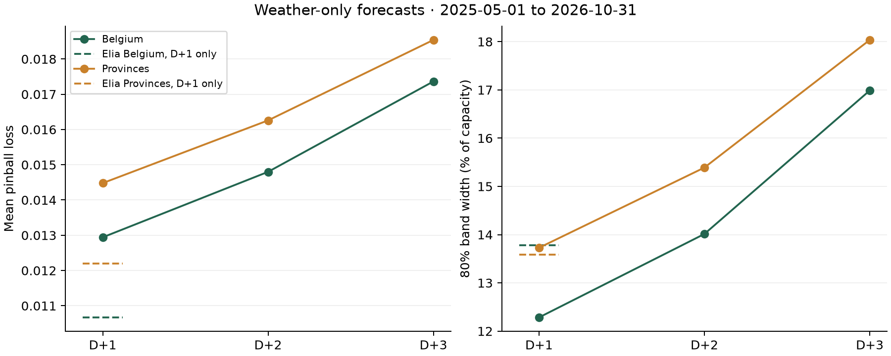

# Devpost submission text

**Project name:** Penumbra

**Elevator pitch:** Solar forecasts with an honest margin: calibrated P10–P90 for any roof, up to three days ahead, 10.8% better than the grid operator's own.

**Track:** DN-SU-01 Solar Energy Generation Forecasting

## Overview
Penumbra tells you how much solar power you can count on. Drop a pin, describe your roof, and get a calibrated P10–P90 range for today and the next three days, the hours you can rely on most, and how much you can safely commit at the risk you choose. It is free, needs no account, installs on a phone, and runs its model on your device.

For Belgium, Penumbra forecasts the national fleet every day next to Elia, the grid operator, and scores both the next morning in a public, hash-chained ledger. On 359 unseen days it cut pinball loss by 10.8% against Elia's own probabilistic forecast, with a band almost a third narrower (9.1% vs 13.3% of capacity) while still covering 80% of outcomes.

## Problem
Grid operators, traders and plant owners commit solar power at 11:00 the day before. They need to know how much they can safely promise, so a single number is not enough. A wide range costs money, because uncertainty has to be covered by reserves or left unsold. Accuracy claims are also hard to check: we found no vendor that publishes a daily record next to the grid operator's own forecast.

## Solution
Penumbra does not re-forecast the weather. It learns where the official forecast goes wrong. A LightGBM model learns the P10, P50 and P90 of the gap to Elia's median, using four weather models, fresh GFS, solar geometry, D-1 morning output and recent Elia error. A rolling conformal step then corrects the band using the last 60 days. A second model uses weather alone, needs no local history, and runs in the visitor's browser for any place.

## Tech stack
Python, pandas, LightGBM, rolling conformal quantile calibration. A static site in plain JavaScript with uPlot, and LightGBM trees exported to JSON for browser inference. A scheduled daily job maintains the ledger.

## Implementation and demo
- Live site: https://yy5652-hash.github.io/penumbra/
- Presentation: https://yy5652-hash.github.io/penumbra/deck.html · [PowerPoint download](https://yy5652-hash.github.io/penumbra/Penumbra_DATANOVA_2026.pptx)
- Code: https://github.com/yy5652-hash/penumbra
- Forecast tool: pick a place on a map, by search or GPS; up to three roof arrays with capacity, tilt, direction and an optional inverter limit, using forecast irradiance on each tilted plane; Today to In 3 days; P10/P50/P90 energy and a 15-minute chart; the most reliable hours of the day; a risk slider that turns the band into a commitment; saved sites, share links, CSV and JSON export; installable on a phone, with the last forecast available offline.
- Public ledger: one forecast per day, each carrying the hash of the one before, checked in the browser. Live forecasts begin with 4 November 2026.
- Parity tests confirm that the browser matches Python to 0.0001 on real weather responses.

## Results and validation
Inputs include four weather models from runs at least 48 hours old, fresh GFS 00z of D-1 from the NOAA archive, and D-1 morning measured output before the 11:00 cutoff. Training history starts in 2021. Other output lags stop at D-2. Choices were made on May to October 2025. Scores cover 359 test days, November 2025 to October 2026. The test window was used twice: first by v1, then by v2, which was chosen on validation and frozen in 6e8d5b8 before its single run. The first frozen version was v1 (`2d11d22`).

| Method | Scope | Pinball | MAE | 80% coverage | Band width |
|---|---|---|---|---|---|
| Elia day-ahead 11:00 | Belgium | 0.0101 | 2.98% | 81.9% | 13.3% |
| Penumbra v2 | Belgium | 0.0090 (-10.8%) | 2.79% | 80.2% | 9.1% |
| Elia day-ahead 11:00 | 11 provinces | 0.0117 | 3.54% | 75.4% | 13.2% |
| Penumbra v2 | 11 provinces | 0.0105 (-10.0%) | 3.28% | 80.2% | 10.5% |

Paired daily pinball difference: Belgium -0.00106 [-0.00134, -0.00077]; provinces -0.00112 [-0.00135, -0.00090] (95% confidence intervals). Quartz, the strongest open-source baseline we found, scored 11.9% MAE on the same provinces with the same-age weather. In three British regions the Belgium-trained weather model reached 4.14% MAE against 11.1% for Quartz, with 75.4% band coverage and no local calibration.

## Impact
The average Belgian band falls from 1,561 MW to 1,073 MW. Mean P10 rises from 1,851 MW to 2,054 MW. Output met P10 in 89.9% of intervals for Penumbra, against 90.4% for Elia. Provincial band width falls from 13.2% to 10.5%, while coverage rises from 75.4% to 80.2%.

## Team contributions
Yi Yu: problem framing, data, modelling, validation, product and presentation. AI coding assistants helped write and check code.

## Third-party acknowledgements
Elia Open Data; NOAA GFS archive; Open-Meteo.com (CC BY 4.0); Sheffield Solar PV_Live; Energy-Charts; Quartz Solar Forecast (MIT), used only as a baseline; uPlot (MIT); Leaflet (BSD-2-Clause) with OpenStreetMap data (ODbL); rany2/open-meteo-solar-forecast (MIT), whose multi-array approach was adapted; Matplotlib; PptxGenJS; Playwright.

<!-- horizons:start -->
## Horizons

Weather-only models. Fixed features and parameters for all horizons. 2025-05-01 to 2026-10-31. Common daylight rows: 321,625 across 549 days. Monthly refits and rolling scoped calibration use a gap of 2, 3 or 4 days. Full-day lags end before the issue day; the frozen weather specification uses no output lags. Elia is a D+1 reference only. Its score uses rows with a published day-ahead forecast.

| Horizon | Scope | Pinball | MAE | Cover 80 | Width |
|---|---|---|---|---|---|
| D+1 | Belgium | 0.012942 | 4.19% | 79.07% | 12.28% |
| D+1 | Provinces | 0.014479 | 4.68% | 79.47% | 13.73% |
| D+2 | Belgium | 0.014799 | 4.80% | 78.62% | 14.01% |
| D+2 | Provinces | 0.016258 | 5.26% | 79.29% | 15.39% |
| D+3 | Belgium | 0.017364 | 5.54% | 79.13% | 16.99% |
| D+3 | Provinces | 0.018541 | 5.93% | 79.67% | 18.04% |

<!-- horizons:end -->
